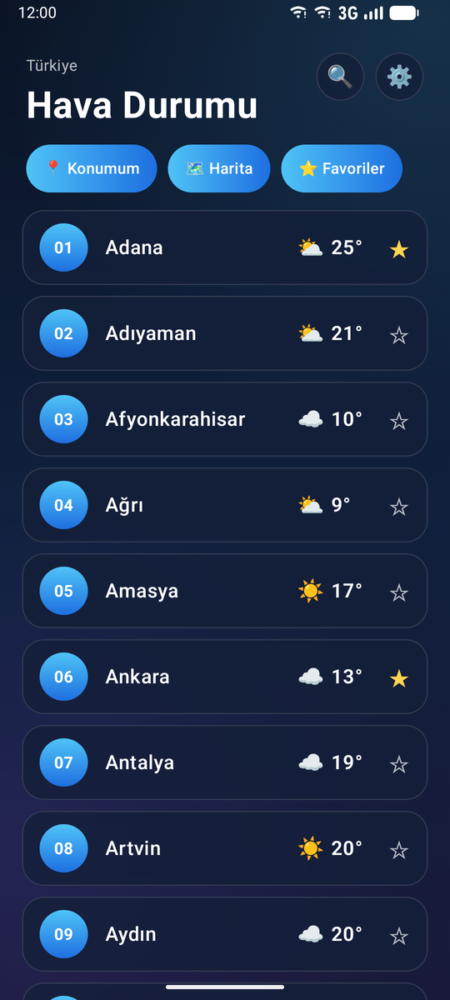
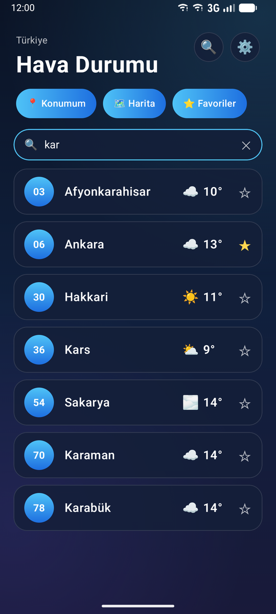
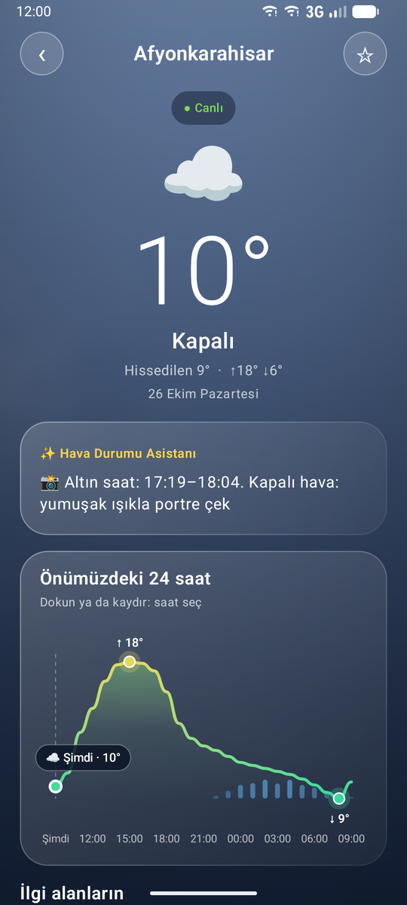
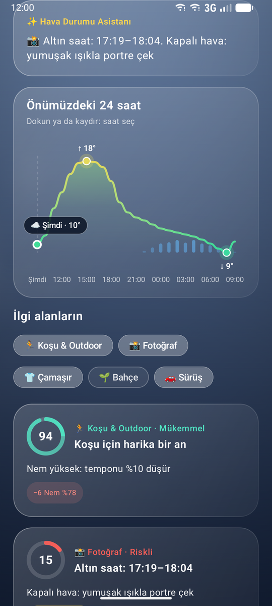
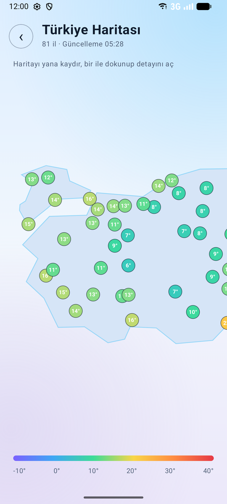
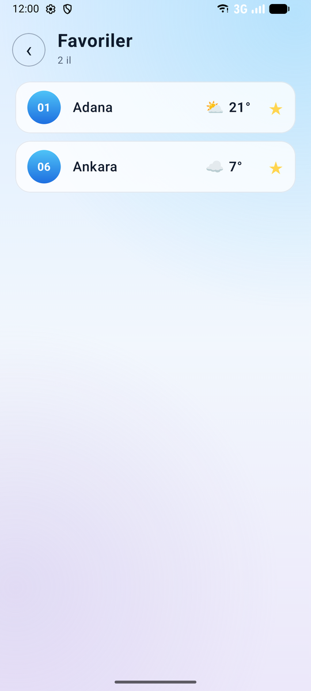
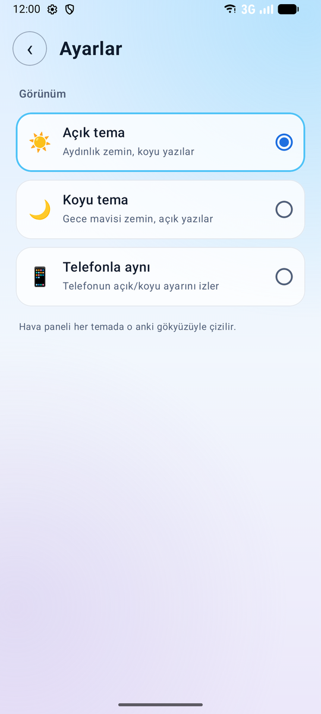
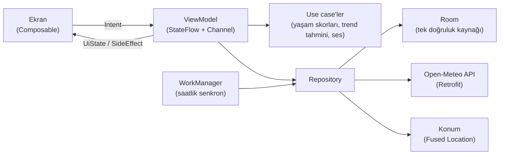

# 🌤️ Hava Durumu

Jetpack Compose ile yazılmış, Türkiye'nin 81 ilinin ve bulunduğun yerin hava durumunu gösteren bir Android uygulaması.
Sadece dereceyi söylemez: koşu, fotoğraf, çamaşır, bahçe ve sürüş için **sana özel skorlar ve en uygun saatler** üretir;
internet yokken bile kayıtlı veriyle çalışmaya devam eder.

**Koyu tema**

| Ana ekran | Arama | Hava paneli | Yaşam skorları |
|:-:|:-:|:-:|:-:|
|  |  |  |  |

**Açık tema**

| Harita | Favoriler | Ayarlar |
|:-:|:-:|:-:|
|  |  |  |

## Özellikler

- **Yaşam tarzı asistanı**: Koşu, fotoğraf (altın saat), çamaşır, bahçe ve sürüş için 0–100 arası skor; her skorun yanında
  "neden bu skor?" çipleri ve en uygun saat aralığı. Hesap tamamen telefonda yapılır, hiçbir veri dışarı gönderilmez
- **Havaya göre canlı arka plan**: Android 13+ cihazlarda AGSL shader ile güneş huzmeleri, yağmur, kar, sis ve şimşek.
  Rüzgârlı günlerde gökyüzünden rüzgâr çizgileri geçer, yağmur eğik yağar. Telefonu eğince damlalar o yöne akar
- **24 saatlik grafik**: Bezier eğrisi, degrade dolgu, en yüksek/en düşük sıcaklık vurgusu, yağış çubukları; dokunup saat seçilebilir
- **Arama**: Yazdıkça süzülür; Türkçe harfler fark etmez ("agri" → Ağrı) ve plaka numarasıyla da aranır ("06" → Ankara)
- **Favoriler**: Ayrı bir ekranda listelenir, uygulama kapanınca kaybolmaz
- **Türkiye haritası**: 81 il sıcaklığına göre renkli yuvarlaklarla; bir ile dokununca detayı açılır
- **Konumum**: Bulunduğun noktanın hava durumu; konum şifreli olarak saklanır
- **Çevrimdışı çalışma**: Veri Room'da tutulur. İnternet yokken son kayıtlı veri gösterilir, eksik saatler trend tahminiyle
  tamamlanır (grafikte kesikli çizgi)
- **Arka plan senkronu ve fırtına bildirimi**: Saatte bir, sadece internet varken ve pil düşük değilken
- **Günün atmosferi**: Havaya ve günün saatine göre telefonda üretilen beyaz/pembe/kahverengi gürültü ve Spotify önerisi
- **Hava kalitesi** (Copernicus CAMS), **ne giysem?** önerisi, ana ekran **widget**'ı
- **Açık / koyu / telefonla aynı tema**, aşağı çekip yenileme, iskelet yükleme animasyonu, hata ve "sonuç yok" ekranları

## Kullanılan teknolojiler

| Konu | Kullanılan |
|---|---|
| Arayüz | Jetpack Compose, Material 3, Navigation Compose, AGSL shader, Canvas |
| Mimari | Clean Architecture katmanları + MVI (State / Intent / SideEffect) |
| Bağımlılık enjeksiyonu | Hilt |
| Ağ | Retrofit, OkHttp (önbellek), kotlinx.serialization |
| Asenkron | Kotlin Coroutines, StateFlow, Channel |
| Veritabanı | Room (KSP), EncryptedSharedPreferences |
| Arka plan | WorkManager, Glance (widget) |
| Donanım | Fused Location, yerçekimi sensörü (arka plan eğimi), AudioTrack (gürültü) |
| Test | JUnit, kotlinx-coroutines-test, sahte (fake) sınıflar |
| Kod biçimi | Spotless + ktlint, GitHub Actions |
| Veri | [Open-Meteo](https://open-meteo.com/) (ücretsiz, API anahtarı gerektirmez) |

## Mimari



- **Ekran** sadece `WeatherUiState`'i çizer; kullanıcının her dokunuşunu bir `WeatherIntent` olarak ViewModel'e gönderir.
- **ViewModel** durumu tek bir `StateFlow`'da tutar. Mesaj göstermek, izin istemek, link açmak gibi tek seferlik olaylar
  `Channel` üzerinden `WeatherSideEffect` olarak gelir; ekran döndürülünce tekrar çalışmaz.
- **Use case'ler** saf Kotlin hesaplamalarıdır (skorlar, trend tahmini); Android'e bağımlı olmadıkları için kolayca test edilir.
- **Repository** Room'u dinler, ağdan gelen veriyi Room'a yazar. Ekran her zaman Room'dan okur, bu yüzden internet
  kesilince ekran boş kalmaz. Testlerde gerçek API ve veritabanı yerine sahte sınıflar verilir.

Ayrıntılar: [docs/ARCHITECTURE.md](docs/ARCHITECTURE.md)

## Yaşam skorları nasıl hesaplanır?

Her ilgi alanı 100 puandan başlar; hava koşulları puan düşürür ya da ekler. Ekrandaki çipler skoru neyin belirlediğini gösterir.
Örneğin yukarıdaki ekran görüntüsünde koşu skoru:

| | Puan |
|---|---:|
| Başlangıç | 100 |
| Nem %78 | −6 |
| **Koşu skoru** | **94 · Mükemmel** |

Hava kötüleştikçe çipler çoğalır: hissedilen 5° ve %88 nemde "Soğuk −12" ve "Nem −14" cezalarıyla skor 74'e (İyi) iner.

- Skor seviyeleri: **80+** Mükemmel · **60+** İyi · **40+** Orta · **20+** Zayıf · altı Riskli
- Gök gürültüsü gibi tek başına tehlikeli durumlar skoru doğrudan bir tavana indirir (fırtınada koşu skoru en fazla 5 olur).
- Önümüzdeki saatler de aynı kurallarla puanlanır; belirgin biçimde daha iyi bir saat varsa "en iyi saat" olarak önerilir.
  Fotoğrafta öneri, gün batımından önceki altın saattir.

Kodu: [`data/CalculateLifestyleIndicesUseCase.kt`](app/src/main/java/com/sukriye/havam/data/CalculateLifestyleIndicesUseCase.kt)

## Çalıştırma

1. Projeyi Android Studio ile aç, Gradle senkronizasyonunun bitmesini bekle.
2. Bir emülatör ya da telefon seçip ▶️ Run'a bas (minSdk 26). Canlı shader arka planı Android 13+ cihazlarda görünür,
   daha eskilerde Canvas animasyonu çalışır.

Testleri ve kod biçimi kontrolünü çalıştırmak için:

```bash
./gradlew spotlessCheck testDebugUnitTest
```

Biçim hatası varsa `./gradlew spotlessApply` otomatik düzeltir. Aynı kontroller her Pull Request'te GitHub Actions ile çalışır.

## Proje yapısı

```
app/src/main/java/com/sukriye/havam/
├── HavamApp.kt              Hilt ve WorkManager'ı başlatır
├── MainActivity.kt          Ayarlardaki temayı kurar, ekranları HavamNavHost'a bırakır
├── model/                   Veri neye benzer? (saf Kotlin)
│   ├── City.kt              81 il, koordinatlar, CitySummary
│   ├── Forecast.kt          Anlık / saatlik / günlük tahmin modelleri
│   ├── Lifestyle.kt         İlgi alanları, skor seviyeleri, ses manzarası
│   ├── ProvinceSearch.kt    İl arama (Türkçe harf ve plaka desteği)
│   └── ...                  Hava kodları, hata türleri, tema seçenekleri
├── data/                    Veri nereden gelir, nasıl işlenir?
│   ├── ApiClient.kt         Hilt modülleri: Retrofit, OkHttp, Room
│   ├── ForecastApi.kt / CityApi.kt          Open-Meteo istekleri
│   ├── WeatherDatabase.kt   Room tabloları
│   ├── WeatherRepository.kt / CityRepository.kt
│   ├── *UseCase.kt          Yaşam skorları, trend tahmini, ses, kıyafet önerisi
│   ├── WeatherSyncWorker.kt Saatlik arka plan senkronu + fırtına bildirimi
│   └── ...                  Konum, tercihler, gürültü çalar, widget güncelleme
└── ui/                      Ne çizilir, ne zaman değişir?
    ├── HavamNavHost.kt      Beş ekran arası geçiş
    ├── city/                İl listesi, harita, favoriler
    ├── forecast/            Hava paneli: ekran, ViewModel, MVI sözleşmesi
    ├── settings/            Tema seçimi
    ├── component/           Shader arka plan, grafik, cam kartlar, ortak bileşenler
    ├── theme/               Renkler (açık/koyu palet), tipografi
    └── widget/              Ana ekran widget'ı
```
